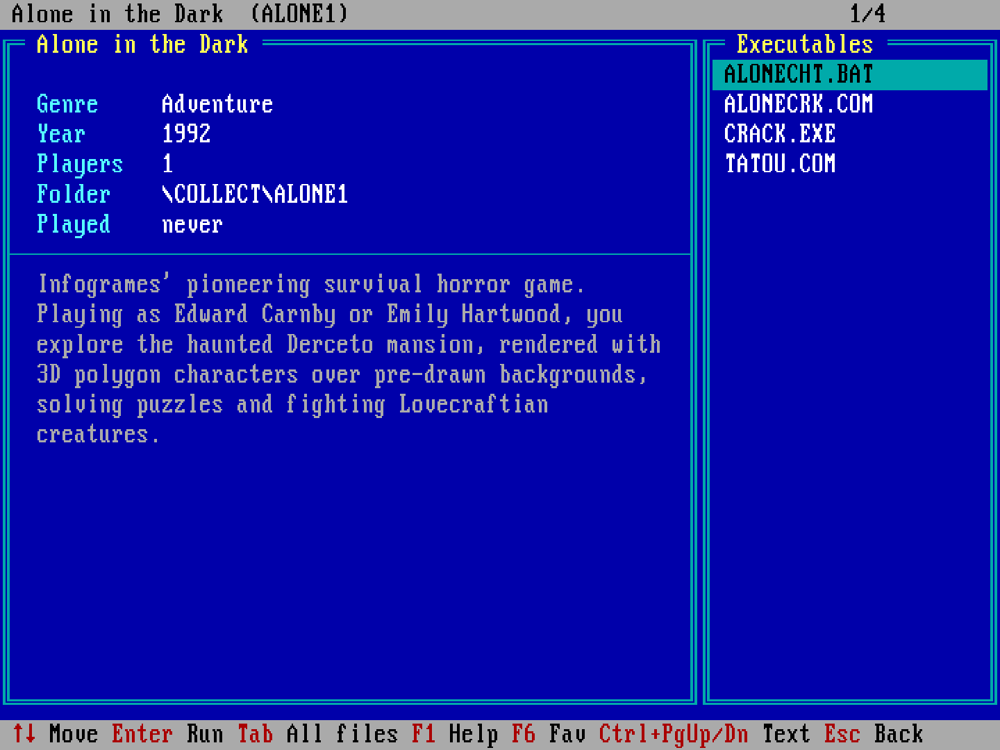

# GMENU – game menu for DOS / DOSBox

GMENU is a small DOS menu program (about 11 KB). It lists the game folders in a directory (`\COLLECT` by default) in a table with the title, genre, year and folder of each game. The data comes from the folder's `METADATA.INI` (or, if there is none, from the first line of `NAME.TXT`). Enter opens a detail page with all the game's data, how many times you played it, and the list of its `.COM`, `.EXE` and `.BAT` files, which you can start. Ctrl+Enter (or a double click) starts the game right away. It works with the keyboard and the mouse (including the wheel), it can search in the titles and descriptions, filter by genre, year (or decade) and number of players, sort by title, year, genre or the most played, and it remembers your favorite and recently played games. It can list the game folders that have no `METADATA.INI` yet, and create or edit a game's `METADATA.INI` with a form (`GMEDIT.COM`).




## Files

| File | Purpose |
|---|---|
| `GMENU.BAT` | Starts the menu. The game directory is set here. |
| `GMENUPRG.COM` | The compiled menu program. |
| `GMEDIT.COM` | Creates or edits a game's `METADATA.INI` with a form (Ctrl+E in the menu, see [Editing METADATA.INI](#editing-metadataini)). |
| `SOURCE/*.asm` | Source code (NASM, 16-bit x86): `GMENU.ASM` is the menu's main file, `GMEDIT.ASM` the editor's; they share `common.asm`, `utf8.asm` and `limits.inc`. |
| `SOURCE/build.sh` | Build script (macOS / Linux). |
| `SOURCE/test/` | Screen tests that run the program in DOSBox (see [Tests](#tests)). |
| `gmenu.ini` | Build settings: `collect_dir` is the default game directory compiled into the program. |
| `GMENURUN.BAT` | *Created at runtime:* starts the selected game. |
| `GMENU.SEL` | *Created at runtime:* the last selected game, the search text, the filters, the sort order, the Tab setting and the recently played games. |
| `GMENU.FAV` | *Created at runtime:* the favorite games (one folder name per line). |
| `GMENU.STA` | *Created at runtime:* how many times and when each game was started. |
| `GMENU.IDX` | *Created at runtime:* a cache of the data read from `METADATA.INI` / `NAME.TXT`, so the menu starts quickly. You can delete it at any time. |

The runtime files are created in the folder of `GMENUPRG.COM`.

## Building

The build needs [NASM](https://www.nasm.us/):

```sh
brew install nasm        # macOS
sudo apt install nasm    # Debian / Ubuntu
```

Then run this from the `SOURCE` folder:

```sh
cd SOURCE
./build.sh
```

It produces `GMENUPRG.COM` and `GMEDIT.COM` in the parent folder. `build.sh` takes the default game directory from `collect_dir` in `gmenu.ini` (used when `GMENU.BAT` gives no directory), and it checks that the program and its data fit in the 64 KB segment. To build by hand: `nasm -f bin -o ../GMENUPRG.COM GMENU.ASM` and `nasm -f bin -o ../GMEDIT.COM GMEDIT.ASM` (from `SOURCE/`).

## Installation

1. Copy the `GMENU` folder to the DOS drive, for example to `C:\GMENU\`. It can be in any folder (for example `C:\TOOLS\GMENU\`). The menu needs only `GMENU.BAT` and `GMENUPRG.COM`, and `GMEDIT.COM` for editing `METADATA.INI` files.
2. Put the games in one common directory. Give each game its own folder, and put a `METADATA.INI` (or at least a `NAME.TXT`) in each folder:
   ```
   C:\COLLECT\
     DOOM\
       METADATA.INI  <- title, genre, year, players, description, what to run
       DOOM.EXE
     PRINCE\
       NAME.TXT      <- first line is the displayed name, e.g. "Prince of Persia"
       PRINCE.EXE
   ```
   `METADATA.INI` looks like this (every line is optional, the keys are not case sensitive, the `[GAME]` line and lines starting with `;` are ignored):
   ```ini
   [GAME]
   NAME=Doom
   GENRE=Shooter
   YEAR=1993
   PLAYERS=1-4
   DESCRIPTION=The whole description in one line...
   DESCRIPTION=A second DESCRIPTION line starts a new line.\nSo does \n inside the text.
   RUN=DOOM.EXE -nomusic
   ARGS=-skill 3
   SETUP=SETUP.EXE
   ```
   - If `METADATA.INI` has no `NAME`, the title comes from `NAME.TXT`. If there is neither, the menu shows the folder name. Missing fields are shown as `-`.
   - `DESCRIPTION`: `\n` is a line break, `\\` is a backslash, an empty `DESCRIPTION=` line gives an empty line.
   - `PLAYERS` can be a number (`2`), a range (`1-4`) or open-ended (`2+`).
   - `RUN` is the command that Ctrl+Enter / double click starts (a file of the game's folder, with optional arguments). `ARGS` is added to it, also when you run the `RUN` file from the detail page. `SETUP` is the setup command, started with Ctrl+S.
   - The files can be UTF-8 (with or without BOM) or code page 437. UTF-8 accented letters are converted to code page 437; letters it does not have (for example `ő`, `ű`, `Á`) are shown as the closest one (`ö`, `ü`, `A`).
3. *(Optional)* In the `[autoexec]` section of your DOSBox config, add the menu to the PATH and start it at boot:
   ```
   [autoexec]
   mount c /Users/.../Dosbox
   c:
   path Z:\;C:\GMENU
   gmenu
   ```

### Setting the game directory

In `GMENU.BAT`, the last argument on the `GMENUPRG.COM` line is the game directory:

```bat
%0PRG.COM /B \COLLECT
```

Add `/A` (for example `/B /A \COLLECT`) to show all files of a game on the detail page by default, not only the executables. (Tab switches between the two at any time.)

You can change it, for example to `\MYGAMES` or `D:\GAMES`. If you give another drive, the menu switches to that drive before it starts the game and switches back afterwards. If you leave the directory out, the menu uses `collect_dir` of `gmenu.ini` (set when the program was built, `\COLLECT` by default). Keep the `/B` switch (see below).

## Usage

Start the menu with `gmenu` (if its folder is in the PATH), or with its full path, for example `C:\GMENU\GMENU`. Do not type the `.BAT` extension: `GMENU.BAT` finds `GMENUPRG.COM` and `GMENURUN.BAT` from the name it was started with.

F1 shows the keys in a table (↑ ↓, PgUp/PgDn or the wheel scroll it, Esc closes it).

### Game list

| Key / mouse | Action |
|---|---|
| ↑ ↓, PgUp/PgDn, Home/End | Move in the list (↑ on the first game jumps to the last one, ↓ on the last to the first) |
| Mouse wheel | Move 3 games up / down |
| Click | Select a game; a click on the selected game opens its detail page |
| Enter, → | Open the game's detail page |
| Ctrl+Enter, double click | Play: start the `RUN` command of `METADATA.INI`; without `RUN`, the game's only executable; if it has more executables (or none), the detail page opens |
| Ctrl+S | Start the `SETUP` command of `METADATA.INI` |
| Ctrl+E | Create or edit the game's `METADATA.INI` (see [Editing METADATA.INI](#editing-metadataini)) |
| Typing | Search: the list narrows to the matches as you type (it searches the title, the folder name and the description, and it ignores case) |
| Backspace | Delete one character from the search |
| F1 | Help (all keys) |
| F2 / F3 / F4 | Filter by genre / year / number of players (pick a value from a list, `(all)` removes the filter). The year list starts with the decades (`1990s`). A player count matches the games whose `PLAYERS` range contains it (`1-4` matches 2). |
| F5 | Clear all filters (including favorites only and without `METADATA.INI` only) |
| F6 | Mark / unmark the selected game as a favorite (yellow `*` at the end of the row) |
| F7 | Show only the favorites / all games |
| Shift+F7 | Show only the games without `METADATA.INI` / all games (the header shows `No METADATA.INI`) |
| F8 | Recently played games (the last 10, newest first); Enter opens the game's detail page |
| F9 | Sort order: title → year → genre → most played (games without the value come last; the order is remembered) |
| F10 | Select a random game of the list |
| Esc or right click | The first press clears the search, the next one the filters, the last one quits |
| Click on the header / footer | Page up / down |

When a search or a filter is active, the header shows how many games match, for example `Found: 42 of 318`. The header also shows the sort order if it is not by title. The number in the top right corner is the position in the list.

### Detail page (inside a game)

On the left: title, genre, year, players, folder, how many times and when you last played, and the description. On the right: the executables, or all files after Tab (executables are marked with ►). The `RUN` file is marked with a yellow ► and is selected first.

| Key / mouse | Action |
|---|---|
| ↑ ↓, PgUp/PgDn, Home/End | Move in the file list (wraps around at the ends) |
| Mouse wheel over the file list | Move 3 files up / down |
| Enter, → or left click | Run the file (only `.COM`, `.EXE`, `.BAT`; the `RUN` file gets the `RUN` arguments and `ARGS`, the `SETUP` file the `SETUP` arguments) |
| Ctrl+PgUp / Ctrl+PgDn, Shift+PgUp / Shift+PgDn | Scroll the description by a page (↑ / ↓ on the frame show that there is more) |
| Mouse wheel over the description | Scroll the description by 3 lines |
| Tab | Show all files / only the executables |
| Letter / digit | Jump to the next file that starts with it |
| F1 | Help |
| F6 | Mark / unmark the game as a favorite |
| Ctrl+E | Create or edit the game's `METADATA.INI` |
| Esc, ← or right click | Back to the game list |

When you quit a game, the menu starts again on the same game, with the same search, filters and sort order, and the current folder is the one you started the menu from.

The mouse wheel needs a driver with the CuteMouse WheelAPI (for example DOSBox Staging's built-in mouse driver or CuteMouse 2.x). Without it, the menu works as before, only the wheel does nothing.

### Editing METADATA.INI

Ctrl+E (in the list or on the detail page) opens `GMEDIT.COM`, a form with the fields of the game's `METADATA.INI`. Shift+F7 lists the games that have none yet. If the game has a `METADATA.INI`, the form shows its values; if not, the form starts with what the folder tells:

- `NAME`: the first line of `NAME.TXT`, or the folder name,
- `RUN`: the executable, if the folder has only one besides the setup programs,
- `SETUP`: the first `SETUP*` or `INSTALL*` executable.

The executables of the folder are listed under the form. `DESCRIPTION` is one line; type `\n` where a new line starts.

| Key | Action |
|---|---|
| Tab, Enter, ↓ / Shift+Tab, ↑ | Next / previous field |
| ← →, Home/End, Backspace, Del | Edit the field |
| Ctrl+Y | Clear the field |
| F2 | Save `METADATA.INI` and return to the menu |
| Esc | Cancel (nothing is written) |

Saving changes only the lines of the values you changed: comments, other keys and the untouched values stay as they were (also their UTF-8 letters that code page 437 does not have, for example `ő`). A changed value is written in UTF-8 in place of its first line (more `DESCRIPTION=` lines become one, with `\n`), a new one at the end; a value you empty loses its line. If nothing changed, nothing is written. A new file starts with `[GAME]` and gets the values that are not empty. The file is first written as `METADATA.$$$`, then renamed. A `METADATA.INI` larger than 8 KB cannot be edited.

Back in the menu the game shows its new data (and a new one drops out of the Shift+F7 list). `GMEDIT.COM` also works on its own: `GMEDIT C:\COLLECT\DOOM`.

## How it works

`GMENUPRG.COM` is not in memory while a game runs, so the game gets all the free memory:

1. `GMENU.BAT` runs `GMENUPRG.COM /B <directory>` (as `%0PRG.COM`, so `C:\GMENU\GMENU` runs `C:\GMENU\GMENUPRG.COM`).
2. When you choose a game, the program writes `GMENURUN.BAT` into its own folder and exits with code 0. When you quit, the exit code is 1, and on an error it is 2. `GMENURUN.BAT` looks like this:
   ```bat
   @echo off
   C:
   cd \COLLECT\DOOM
   DOOM.EXE -nomusic -skill 3     (for a .BAT file: call XY.BAT)
   C:
   cd \                           (the folder the menu was started from)
   ```
3. `GMENU.BAT` runs it (with `call %0RUN.BAT`) and then starts the menu again.

Ctrl+E works the same way: `GMENURUN.BAT` runs `GMEDIT.COM` (from the folder of `GMENUPRG.COM`) with the game's folder, for example `C:\GMENU\GMEDIT.COM /B C:\COLLECT\DOOM` (`/B`: an error message waits for a key, so that the menu does not clear it at once).

The `/B` switch tells the program that `GMENU.BAT` started it. Without the switch, the program does not open the menu. It only prints that you must use `GMENU.BAT`. If it ran on its own, it would write `GMENURUN.BAT`, but nothing would start the game.

On start, the program checks each game's `METADATA.INI` (and `NAME.TXT`) date, time and size. If they did not change, the data comes from `GMENU.IDX` and the files are not read; otherwise they are read again and `GMENU.IDX` is rewritten.

## Tests

`SOURCE/test/run.py` builds the program with a list of keystrokes for each case in `SOURCE/test/cases.txt`, runs it in DOSBox on the sample games in `SOURCE/test/collect`, and compares the screen (or the written `GMENURUN.BAT`, and the `METADATA.INI` files `GMEDIT.COM` wrote) with `SOURCE/test/expected/<case>.txt`. A case can also run `GMEDIT.COM` (see `cases.txt`). It needs Python 3, NASM and DOSBox (DOSBox Staging or DOSBox 0.74; set `DOSBOX=<path>` if it is not found):

```sh
python3 SOURCE/test/run.py              # all cases
python3 SOURCE/test/run.py help sort_year   # some cases
python3 SOURCE/test/run.py --update     # accept the current results as expected
```

A failed case writes its result to `expected/<case>.got`. `.woodpecker.yaml` runs the build and the tests in Woodpecker CI.

## Releases

Pushing a `vX.Y.Z` tag makes Woodpecker build and test the programs, then publish a Gitea release with `RELEASE_NOTES.md` as its text and three files: `GMENU-vX.Y.Z.zip` (the `GMENU` folder to install), `GMENUPRG.COM` and `GMEDIT.COM` (to update an installed menu). The upload (`scripts/ci-upload.sh`) uses the `gitea_token` repository secret, or Woodpecker's forge credential when there is one.

The same tag also puts the menu into the [DOSINST](https://git.teletypegames.org/tools/dosinst) program store (`ftp://ftp.teletypegames.org`), so a DOS machine running DOSINST can install and update it: `scripts/ci-store.sh` writes the `GMENU` folder with an `INFO.INI` (the version is the tag without the `v`) into the server's `/srv/stacks/dosinst/programs`. This step mounts that folder, so the repository has to be trusted for volumes in Woodpecker.

```sh
git tag v1.0.0
git push origin v1.0.0
```

## Limitations

- At most 600 game folders and 600 files per folder. The recent list keeps the last 10 games.
- Titles can be up to 50 characters long, genres 24, year and players 10, descriptions 2000, `RUN` / `SETUP` / `ARGS` 60. `METADATA.INI` is read up to 4 KB.
- The players filter lists the counts from 1 to 16.
- The screen uses code page 437 (see the UTF-8 conversion above).
- Start the menu without the `.BAT` extension (`GMENU`, not `GMENU.BAT`).

## License

MIT – see [LICENSE.md](LICENSE.md).
