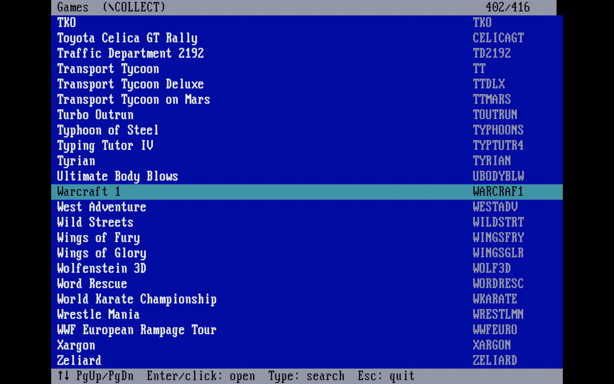

# GMENU – game menu for DOS / DOSBox

GMENU is a small DOS menu program (about 3 KB). It lists the game folders in a directory (`\COLLECT` by default) and names each one after the first line of the folder's `NAME.TXT`. You can start any `.COM`, `.EXE` or `.BAT` file of the selected game. It works with the keyboard and the mouse, and it has a search.



## Files

| File | Purpose |
|---|---|
| `GMENU.BAT` | Starts the menu. The game directory is set here. |
| `GMENUPRG.COM` | The compiled menu program. |
| `GMENU.ASM` | Source code (NASM, 16-bit x86). |
| `build.sh` | Build script (macOS / Linux). |
| `MENURUN.BAT` | *Created at runtime:* starts the selected game. |
| `GMENU.SEL` | *Created at runtime:* the last selected game and the search text. |

## Building

The build needs [NASM](https://www.nasm.us/):

```sh
brew install nasm        # macOS
sudo apt install nasm    # Debian / Ubuntu
```

Then run this in the `GMENU` folder:

```sh
./build.sh
```

It produces `GMENUPRG.COM`. To build by hand: `nasm -f bin -o GMENUPRG.COM GMENU.ASM`.

## Installation

1. Copy the `GMENU` folder to the root of the DOS C: drive, so you get `C:\GMENU\`. The menu needs only `GMENU.BAT` and `GMENUPRG.COM`.
2. Put the games in one common directory. Give each game its own folder, and put a `NAME.TXT` in each folder:
   ```
   C:\COLLECT\
     DOOM\
       NAME.TXT      <- first line is the displayed name, e.g. "Doom"
       DOOM.EXE
     PRINCE\
       NAME.TXT
       PRINCE.EXE
   ```
   If a folder has no `NAME.TXT`, the menu shows the folder name.
3. *(Optional)* In the `[autoexec]` section of your DOSBox config, add the menu to the PATH and start it at boot:
   ```
   [autoexec]
   mount c /Users/.../Dosbox
   c:
   path Z:\;C:\GMENU
   gmenu
   ```

### Setting the game directory

In `GMENU.BAT`, the last argument on the `GMENUPRG.COM` line is the game directory:

```bat
\GMENU\GMENUPRG.COM /B \COLLECT
```

You can change it, for example to `\MYGAMES` or `D:\GAMES`. If you give another drive, the menu switches to that drive before it starts the game and switches back afterwards. If you leave the directory out, the menu uses `\COLLECT`. Keep the `/B` switch (see below).

## Usage

Start the menu:

```
\GMENU\GMENU
```

(or just `gmenu` if `C:\GMENU` is in the PATH)

### Game list

| Key / mouse | Action |
|---|---|
| ↑ ↓, PgUp/PgDn, Home/End | Move in the list |
| Enter, → or left click | Open the game (shows its executable files) |
| Typing | Search: the list narrows to the matches as you type (it searches the title and the folder name, and it ignores case) |
| Backspace | Delete one character from the search |
| Esc or right click | The first press clears the search, the second one quits |
| Click on the header / footer | Page up / down |

### File list (inside a game)

| Key / mouse | Action |
|---|---|
| ↑ ↓, PgUp/PgDn, Home/End | Move |
| Enter, → or left click | Run the file |
| Letter / digit | Jump to the next file that starts with it |
| Esc, ← or right click | Back to the game list |

When you quit a game, the menu starts again on the same game, with the same search.

## How it works

`GMENUPRG.COM` is not in memory while a game runs, so the game gets all the free memory:

1. `GMENU.BAT` runs `GMENUPRG.COM /B <directory>`.
2. When you choose a file, the program writes `\GMENU\MENURUN.BAT` and exits with code 0. When you quit, the exit code is 1, and on an error it is 2. `MENURUN.BAT` looks like this:
   ```bat
   @echo off
   C:
   cd \COLLECT\DOOM
   DOOM.EXE          (for a .BAT file: call XY.BAT)
   C:
   cd \
   ```
3. `GMENU.BAT` runs it (with `call`) and then starts the menu again.

The `/B` switch tells the program that `GMENU.BAT` started it. Without the switch, the program does not open the menu. It only prints that you must use `GMENU.BAT`. If it ran on its own, it would write `MENURUN.BAT`, but nothing would start the game.

## Limitations

- At most 600 game folders and 100 executable files per folder.
- Titles can be up to 50 characters long (the first line of `NAME.TXT`, without leading and trailing spaces).
- The screen uses code page 437, so accented (UTF-8) characters in `NAME.TXT` may display incorrectly.

## License

MIT – see [LICENSE.md](LICENSE.md).
